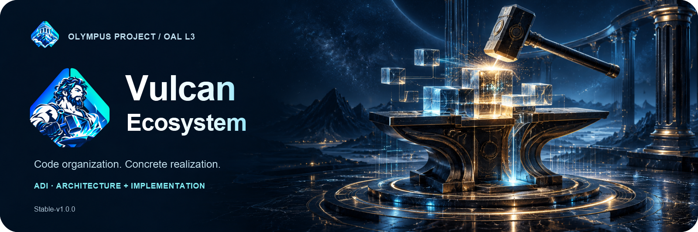
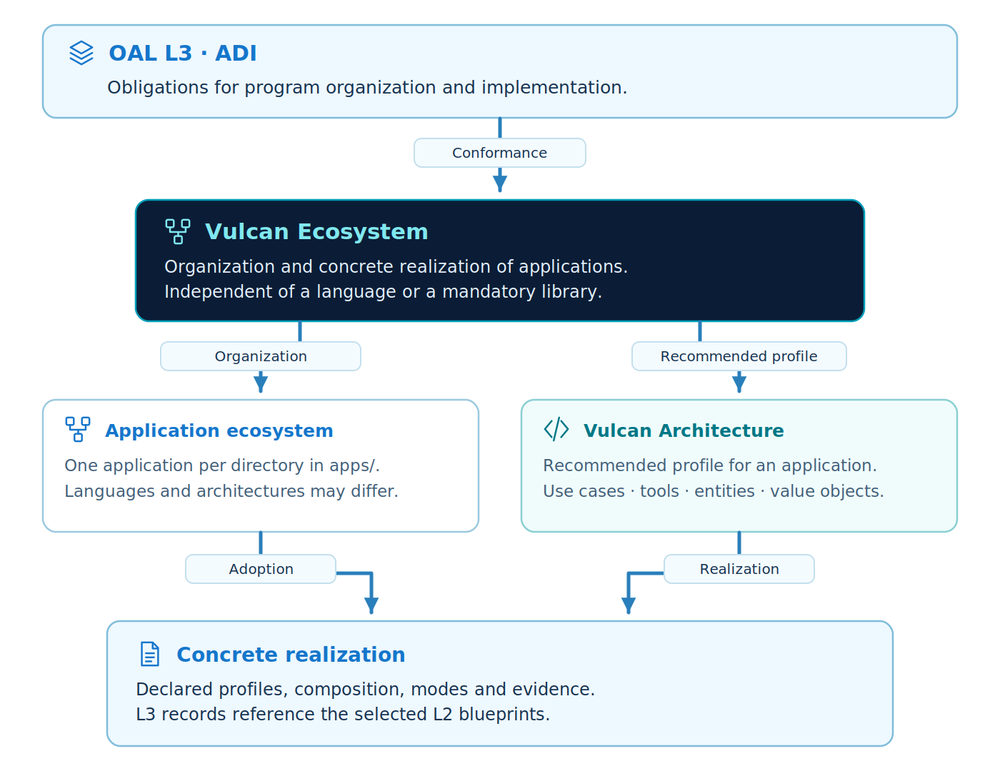
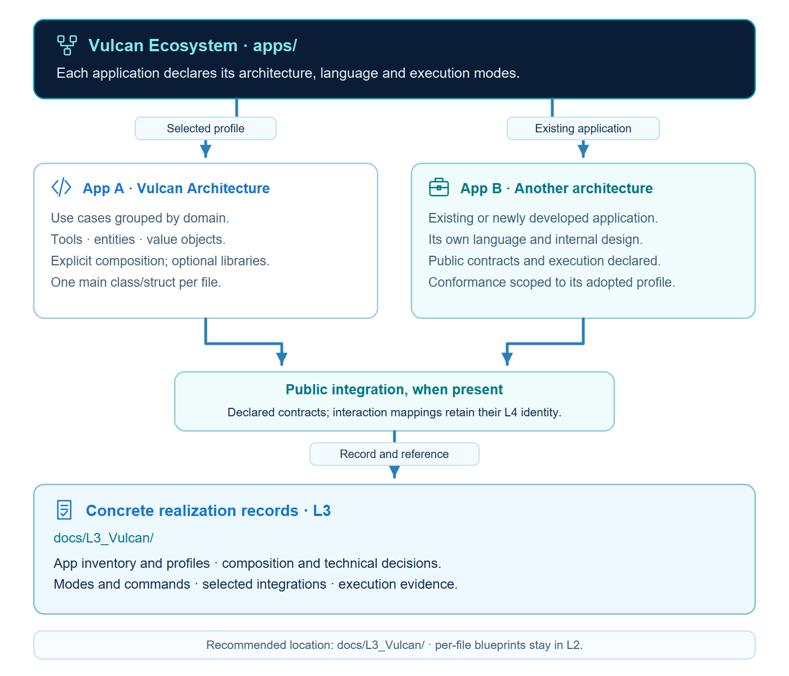
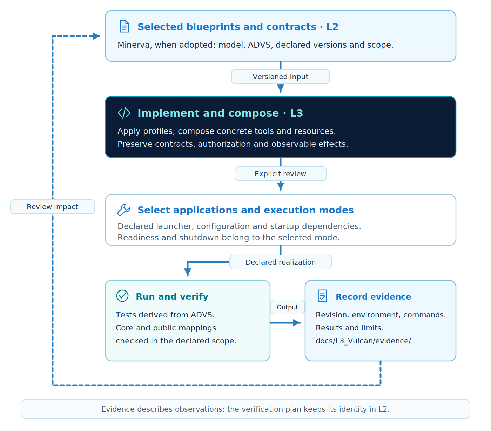

<p align="center"></p>

# Vulcan Ecosystem

[Português brasileiro](README.pt-br.md) · [Edition manual](versioning/Alpha-v0.1.0/README.md) · [Verification](versioning/Alpha-v0.1.0/verification/RELEASE.md)

**A reusable OAL L3 / ADI model for organizing and realizing applications in code.** Part of Olympus Project, alongside Atlas Specifications (L1) and Minerva Blueprints (L2). This illustrated introduction points to the normative English edition manual and its Portuguese translation.



Atlas specifies required behavior; Minerva models the program and its verification; Vulcan organizes concrete implementation, composition, execution and evidence. L4 owns interaction choices. Reference: [OAL Stable-v1.0.0](https://github.com/CodeVaultCommunity/OAL_OpenAnalysisLayers), with exact [source baselines](versioning/Alpha-v0.1.0/verification/source-baselines.json).



Apps declare their own architecture. The optional Vulcan Architecture profile organizes use cases, tools, entities and value objects; other architectures can participate through public contracts. No supporting library, base class or container is required.

## Start with the same examples as Atlas and Minerva

| Example | Focus |
| --- | --- |
| [minimal](versioning/Alpha-v0.1.0/examples/minimal/README.md) | Request submission, exact identity, validation and persistence. |
| [composition](versioning/Alpha-v0.1.0/examples/composition/README.md) | Booking lookup/create/cancel and context-preserving composition. |
| [task-board](versioning/Alpha-v0.1.0/examples/task-board/README.md) | Caller-supplied task IDs, board isolation, revision conflicts and consistent listing. |

The former divergent TaskBoard is retained only as a technical fixture for legacy integration and startup checks. The main examples preserve canonical Atlas source bytes and corresponding Minerva identities.

```sh
cd versioning/Alpha-v0.1.0
python run_examples.py evaluate
python run_examples.py test
python run_examples.py start --example task-board --all --duration 10
```

Python 3.11+. These L3 commands use the standard library. Full integration additionally requires `requirements.txt` and an explicit external Minerva edition: see the [manual](versioning/Alpha-v0.1.0/README.md#quick-start). Each verification run records its environment, source hashes and executed scenarios.



[integrations/](versioning/Alpha-v0.1.0/integrations/README.md) explains manual Minerva-to-Vulcan derivation. It contains documentation only; no translator or generator is implemented. Per-file YAML belongs in L2, while L3 records organization, resources, execution and evidence.

## Repository organization

```text
L3-VulcanEcosystem/
├── README.md / README.pt-br.md
├── AGENTS.md / CLAUDE.md
├── CHANGELOG.md / VERSION / CONTENT-SHA256.json
├── LICENSE
├── assets/                 # illustrated introductions
├── docs/                   # maintenance, contribution, citation and acknowledgements
├── scripts/                # repository and distribution checks
└── versioning/Alpha-v0.1.0/
    ├── README.md / README.pt-br.md
    ├── specification/      # identified rules and OAL alignment
    ├── profiles/           # optional Vulcan Architecture profile
    ├── integrations/       # explanation only: Minerva → Vulcan
    ├── guides/ / templates/
    ├── examples/           # minimal, composition, task-board
    ├── scripts/ / tests/   # assessor, evidence runner, technical fixtures
    └── verification/       # requirements, source baselines, reviews, runs
```

The edition remains **Alpha-v0.1.0**, improved in place before publication. [Rules](versioning/Alpha-v0.1.0/specification/README.md), [OAL alignment](versioning/Alpha-v0.1.0/specification/OAL-ALIGNMENT.md), [requirements](versioning/Alpha-v0.1.0/verification/REQUIREMENTS.md) and [change history](CHANGELOG.md) separate source obligations, design choices and observed checks.

## Integrity and contribution

Root `CONTENT-SHA256.json` inventories exact delivery bytes. [Release procedure](docs/releasing.md) explains staging, verification and local commits. Tests are bounded observations, not stakeholder approval or certification for future projects. Hosted CI configuration is not evidence of a hosted run.

Concept and authorship: Douglas de Oliveira Alkimim. Preparation and technical review were AI-assisted. See [MIT license](LICENSE), [citation](docs/CITATION.cff), [artwork provenance](assets/README.md) and [contribution guide](docs/CONTRIBUTING.md).
