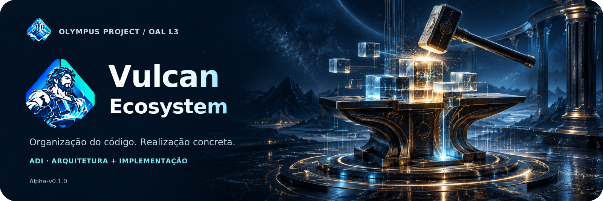
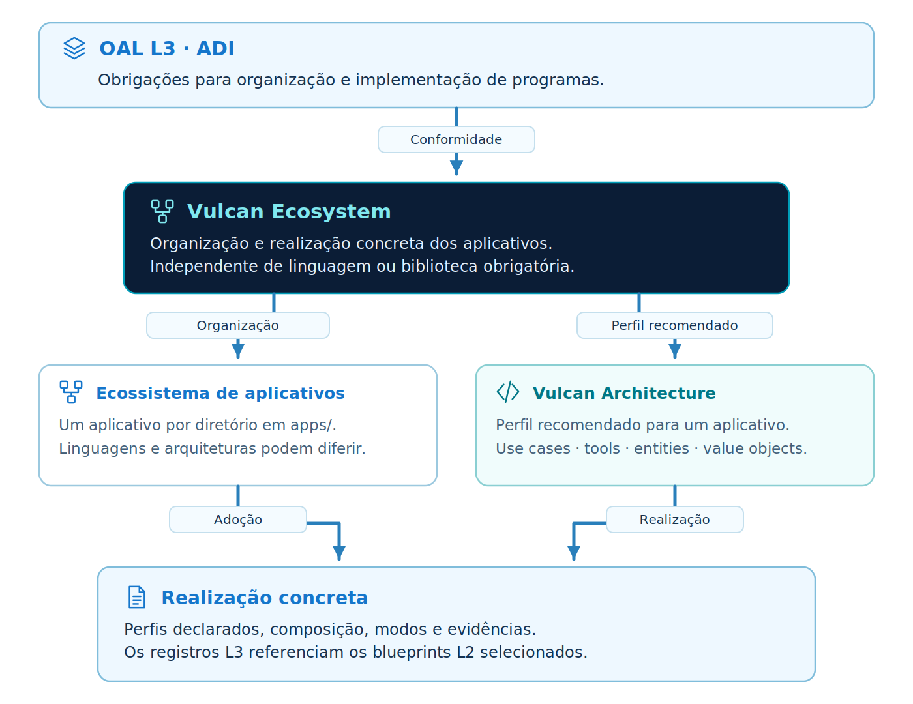
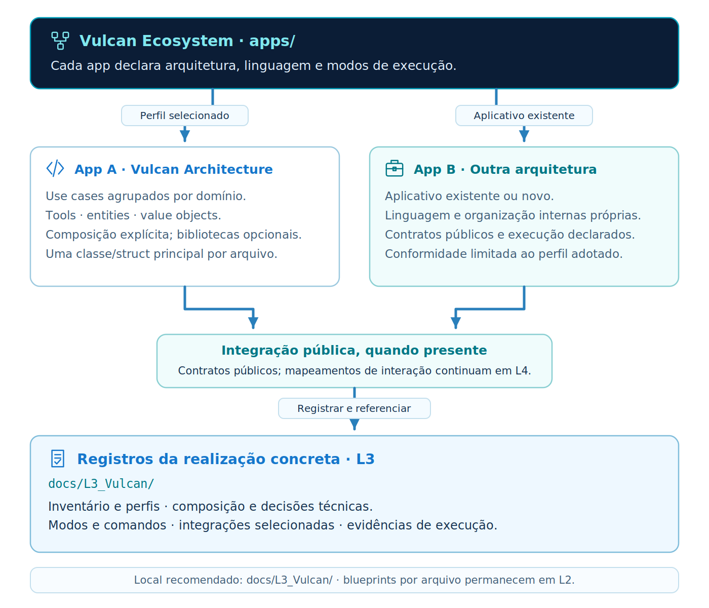
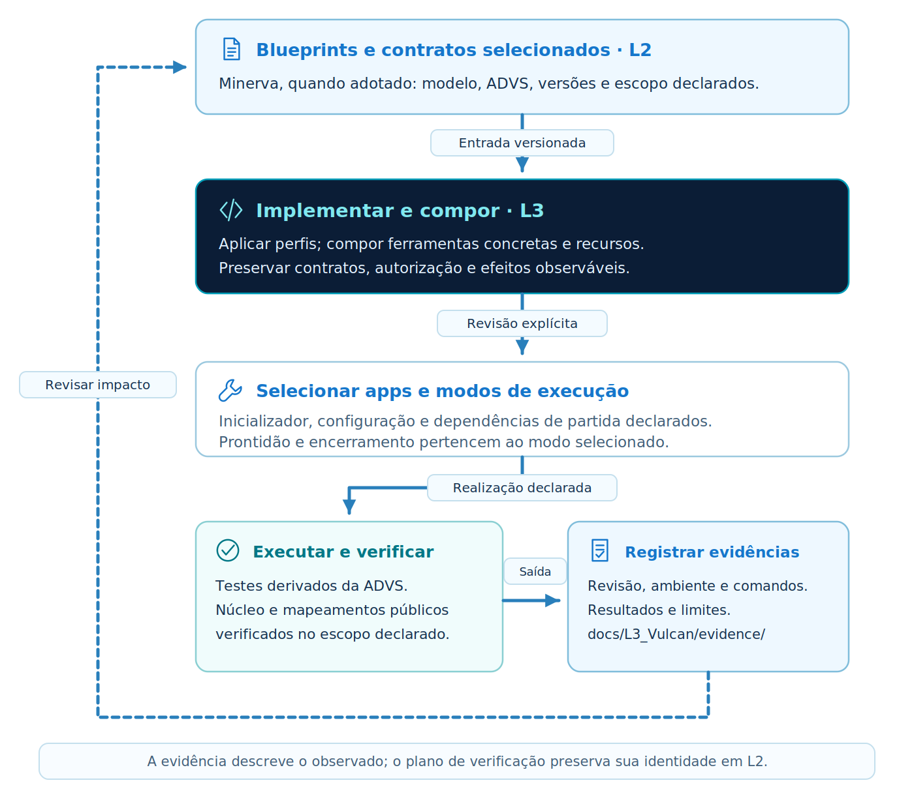

<p align="center"></p>

<p align="center"><strong>Vulcan Ecosystem Alpha-v0.1.0 · OAL L3 / ADI</strong></p>

Português brasileiro · [English](README.md)

# Vulcan Ecosystem

**Vulcan Ecosystem é um modelo de L3 do OAL para organizar e realizar aplicativos em código.** Oferece o perfil Vulcan Architecture, admite aplicativos de outras arquiteturas e define composição explícita, execução completa ou seletiva e vínculo com a modelagem e a verificação.

Integra o **Olympus Project**, junto do Atlas Specifications (L1) e do Minerva Blueprints (L2).

Este README é a apresentação ilustrada. O [manual da edição](versioning/Alpha-v0.1.0/README.pt-br.md) contém as regras textuais. Inglês é normativo; português é sua tradução. A Alpha está pronta para experimentação e revisão; o [relatório de verificação](versioning/Alpha-v0.1.0/verification/RELEASE.md) delimita os resultados observados.

## Conteúdo

- [Posicionamento no Olympus](#position)
- [Ecossistema e arquitetura](#content)
- [Fluxo de trabalho](#workflow)
- [Início rápido](#quick-start)
- [Documentação por camada](#documentation)
- [Exemplos](#examples)
- [Versões](#versions)
- [Organização do repositório](#repository-organization)
- [Verificação e integridade](#verification)
- [Autoria e licença](#authorship)

<a id="position"></a>
## Posicionamento no Olympus

<p align="center"></p>

A referência é [OAL Stable-v1.0.0](https://github.com/CodeVaultCommunity/OAL_OpenAnalysisLayers). O Atlas fornece especificações L1; Minerva reúne ADPM e ADVS em L2; Vulcan organiza a realização em L3. As fontes estão fixadas por revisão e bytes em [source-baselines.json](versioning/Alpha-v0.1.0/verification/source-baselines.json).

<a id="content"></a>
## Ecossistema e arquitetura

<p align="center"></p>

Um ecossistema contém aplicativos identificados em apps/. Cada aplicativo declara seu perfil. Vulcan Architecture organiza casos, ferramentas, entidades e value objects; aplicativos legados mantêm sua arquitetura e expõem operações públicas documentadas.

Consulte as [regras identificadas](versioning/Alpha-v0.1.0/README.pt-br.md#reference-rules) e o [mapeamento dos requisitos](versioning/Alpha-v0.1.0/verification/REQUIREMENTS.pt-br.md). Identidade do modelo, versão do perfil e revisão de um documento permanecem distinguíveis.

<a id="workflow"></a>
## Fluxo de trabalho

<p align="center"></p>

Selecione o modelo de programa, componha as ferramentas concretas e os casos, prepare os canais e execute os modos declarados. Registre os resultados dos testes e compare-os aos cenários especificados. Bibliotecas, classes abstratas e frameworks de injeção são opcionais.

<a id="quick-start"></a>
## Início rápido

Use Python 3.11 ou superior. Na raiz extraída, execute:

```bash
cd versioning/Alpha-v0.1.0
python -m venv .venv
# POSIX: source .venv/bin/activate
# PowerShell: .venv\Scripts\Activate.ps1
python -m pip install -r requirements.txt
python run_examples.py verify
python run_examples.py list
python run_examples.py start --all --duration 10
```

A edição contém suas ferramentas e recursos. Consulte os comandos e pré-requisitos completos no [manual](versioning/Alpha-v0.1.0/README.pt-br.md#quick-start). O projeto distribui um modelo e ferramentas de referência; a biblioteca de conveniência permanece opcional.

<a id="documentation"></a>
## Documentação por camada

| Local recomendado | Conteúdo |
| --- | --- |
| `docs/L1_AtlasSpecifications/` | Casos e contratos de origem. |
| `docs/L2_MinervaBlueprints/` | ADPM, ADVS e espelho YAML por arquivo. |
| `docs/L3_Vulcan/` | Organização, composição, operação, integrações e evidências. |
| `docs/Shared/` | Apoio e assuntos transversais, com referências canônicas. |

Docs/ na raiz é recomendado. Uma alternativa declarada pode preservar as informações e os vínculos exigidos. As fichas por arquivo pertencem ao Minerva: apps/TaskBoard/entities/Entity_Task.py corresponde a docs/L2_MinervaBlueprints/apps/TaskBoard/entities/Entity_Task.py.yaml. O repositório de especificação mantém sua própria organização editorial.

<a id="examples"></a>
## Exemplos

| Exemplo | O que demonstra |
| --- | --- |
| [TaskBoard + LegacyReports](versioning/Alpha-v0.1.0/examples/task-board-ecosystem/README.pt-br.md) | Aplicativo Vulcan, legado, HTTP, CLI, persistência e inicialização coordenada. |
| [Structural counterexamples](versioning/Alpha-v0.1.0/tests/) | Violações de nomes, estrutura e dependências. |

O TaskBoard usa uma instância Atlas própria, reconstruída e didática. Seu contrato difere do Task Board publicado pelo Atlas. Origem, diferenças e limites estão identificados nos documentos do exemplo; não se afirma geração automática nem aprovação independente de stakeholders.

<a id="versions"></a>
## Versões

| Edição | Status | Manual e notas | Verificação |
| --- | --- | --- | --- |
| Alpha-v0.1.0 | Alpha | [English](versioning/Alpha-v0.1.0/README.md#release-notes) · [Português](versioning/Alpha-v0.1.0/README.pt-br.md#release-notes) | [Report](versioning/Alpha-v0.1.0/verification/RELEASE.md) |

Cada edição contém suas dependências, ferramentas, exemplos e testes. Esta distribuição inclui somente Alpha-v0.1.0; revisões futuras deverão preservar os snapshots publicados e declarar migrações.

<a id="repository-organization"></a>
## Organização do repositório

| Local | Finalidade |
| --- | --- |
| `README.md`, `README.pt-br.md` | Apresentação ilustrada e navegação. |
| [`assets/`](assets/README.pt-br.md) | Ícones fornecidos, headers, diagramas e fontes editáveis. |
| [`versioning/Alpha-v0.1.0/`](versioning/Alpha-v0.1.0/README.pt-br.md) | Manual textual e edição autossuficiente. |
| [`CONTENT-SHA256.json`](CONTENT-SHA256.json) | Inventário único de bytes e hashes de distribuição. |
| [`scripts/`](scripts/) | Verificação de links, inventário e empacotamento. |
| [`docs/releasing.pt-br.md`](docs/releasing.pt-br.md) | Procedimento reproduzível de distribuição. |
| [`AGENTS.md`](AGENTS.md), [`CLAUDE.md`](CLAUDE.md) | Navegação e manutenção assistida. |

<a id="verification"></a>
## Verificação e integridade

```bash
python scripts/check_archive.py .
python scripts/check_repository.py
```

Execute a auditoria do diretório logo após extrair, antes de criar ambientes ou caches dentro dele. O inventário cobre todos os arquivos distribuídos, exceto ele próprio. Detecta ausências, acréscimos e alterações. O [guia de release](docs/releasing.pt-br.md) distingue verificações locais, CI configurada e publicação remota.

<a id="authorship"></a>
## Autoria e licença

Conceito e autoria do projeto: **Douglas de Oliveira Alkimim**. Preparação desta Alpha com assistência de IA, para revisão. Distribuído sob a [licença MIT](LICENSE). Créditos das fontes e dos recursos em [ACKNOWLEDGEMENTS.md](ACKNOWLEDGEMENTS.md); metadados em [CITATION.cff](CITATION.cff).

<p><strong>Douglas de Oliveira Alkimim</strong><br><a href="https://github.com/douglas-alkimim">GitHub</a> · <a href="https://www.linkedin.com/in/douglas-alkimim/">LinkedIn</a></p>
<br clear="all">
